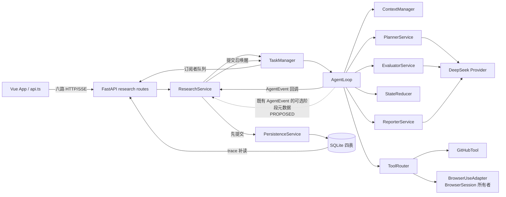
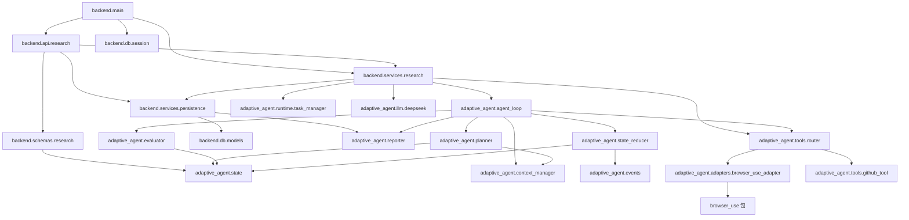

# 系统架构：当前事实与目标方案

状态：**APPROVED（设计）** · 实施未授权 · ADR：[0001](adr/0001-target-architecture.md) · 审计基线：`dbacdc02`

当前事实来自 [Gate 0 审计](10_CURRENT_STATE_AUDIT.md)及源码；本文件是已冻结的目标设计，须在 G2-00 权威迁移和对应任务执行授权后才指导代码修改。`ARC-001` 对应创建与队列，`ARC-002` 动态执行，`ARC-003` 证据，`ARC-004` 报告，`ARC-005` 事件与历史，`ARC-006` 取消/恢复，`ARC-007` 诊断，`ARC-008` 可选导出/模板。NFR 设计锚点用 `ARC-N01` 至 `ARC-N06`。

## 1. 方案选择

| 方案 | 边界与复杂度 | 性能/失败恢复 | 可测性、时间与运营 | 面试价值与结论 |
|---|---|---|---|---|
| A 现有单进程模块化单体定点优化 | Vue→FastAPI→ResearchService/TaskManager→AgentLoop；低迁移成本 | 最多两个并发任务；重启终结未完成任务，无续跑；针对 Token/事实/终态修复 | 复用现有 fake 注入、SQLite/SSE；约四周 57h，无新增常驻服务 | 能解释 Agent Loop、状态、证据、失败与评测；**设计已冻结，实施未授权** |
| B 独立任务 Worker/调度边界 | 需新进程队列、跨进程取消、事件通知和部署协议 | 可隔离 API 与浏览器负载，但恢复语义须重定 | 测试/运维成本高于当前故障收益；若出现已测得 API 饥饿再立 ADR | 展示分布式能力，但当前属过度建设；暂缓 |
| C LangGraph 重构 | 迁移状态、事件、工具和报告；可能双轨 | 可用 checkpoint，但浏览器副作用重放和幂等仍需自己解决 | 学习/迁移/回归成本最高且增加依赖 | 当前 No-Go 不能由框架替代真实业务修复；不采用 |

目标仍是 A。`TaskManager` 已是明确进程内调度边界，不新增 Worker 服务。保留 Pydantic 域模型、SQLAlchemy ORM、FastAPI DTO 三层，避免状态中混入 BrowserSession、HTTP client、SQLAlchemy Session 或 SSE queue。Provider 与工具依赖经已有构造注入，按真实痛点增强，不新建通用插件框架。

## 2. 图 1：System Context

`VERIFIED` 当前系统边界和外部依赖；图中“设计诊断视图”仅为 `PROPOSED`。

```mermaid
flowchart LR
  User["开发者用户"] -->|目标 / 查看结果 / 取消| ARA["Adaptive Research Agent<br/>本机研究系统"]
  ARA -->|GitHub REST 请求| GH["GitHub API"]
  ARA -->|规划、评估、报告请求| LLM["DeepSeek LLM Provider"]
  ARA -->|浏览器动作| Chrome["本机 Chromium / browser-use"]
  Chrome -->|HTTP(S) 页面访问| Web["公开文档与发布页面"]
  ARA -->|任务、事实、步骤、轨迹| DB[("本机 SQLite")]
  ARA -->|状态、SSE、报告；设计诊断视图| User
```

节点说明：用户只通过 Vue/API 交互；GitHub API 供结构化仓库/发布信息，Chromium 供页面语义观察，DeepSeek 供规划与必要的评估/报告分组，SQLite 保存可重读任务。契约分别是六路 Research HTTP/SSE、`ToolResult`、provider 结构化输出与四张 ORM 表。取舍：外部网页是非可信数据，密钥只在服务端；当前仅可信本机部署，不能把 URL 后置校验称为公网 SSRF 防护。

## 3. 图 2：Container / Deployment Architecture

`VERIFIED` 当前部署为单个 Python API 进程及本机 Vue 开发/静态资源进程；浏览器是本机子资源。目标只增加诊断展示和安全运行说明，**不画独立 Worker、Redis 或集群**。

```mermaid
flowchart TB
  subgraph Host["可信本机 / 单用户环境"]
    BrowserUI["用户浏览器<br/>Vue 3 页面"] -->|HTTP + SSE| API["FastAPI / Uvicorn<br/>单 Python 进程"]
    subgraph APIProcess["同一个 Python 进程"]
      Service["ResearchService"]
      Manager["TaskManager<br/>asyncio Task + Semaphore"]
      Runtime["AgentLoop 与领域服务"]
      Service --> Manager --> Runtime
    end
    API --> Service
    Service -->|AsyncSession| SQLite[("SQLite / aiosqlite")]
    Runtime --> Adapter["BrowserUseAdapter"]
    Adapter --> Chromium["本机 Chromium<br/>每任务会话资源"]
    FrontendBuild["Vue / Vite 构建资源"] -.-> BrowserUI
  end
  Runtime -->|HTTPS| DeepSeek["DeepSeek"]
  Runtime -->|HTTPS| GitHub["GitHub API"]
  Chromium -->|HTTP(S)| Pages["外部公开页面"]
```

数据契约：Python 3.12/3.13、Node 22 锁定安装、`uv.lock`、`frontend/package-lock.json`、环境变量注入与本机 SQLite 路径见 [README](../../README.md)、[pyproject](../../pyproject.toml)和 [CI](../../.github/workflows/ci.yml)。一个进程拥有内存任务与订阅者；多 Uvicorn worker/多实例没有共享队列、取消信号或唤醒机制，不在目标部署内。重启依赖数据库将未终结行变为 `partial/failed + server_restart`，不续跑。

## 4. 图 3：Component Architecture

实线为当前调用或数据流；虚线 `PROPOSED` 为现有事件 JSON 上的分阶段诊断元数据。数据库写入由 Persistence 独占；浏览器会话由 Adapter 创建/关闭，AgentLoop 在 `finally` 触发关闭；发布给 SSE 的队列只唤醒读取。



组件契约：`Planner.next_step` 输出单个 `PlanDecision`；`ToolRouter.execute` 输出 `ToolResult`；`Evaluator.evaluate` 输出 `EvaluationResult`；`AgentEvent → StateReducer → ResearchState` 是域状态路径；`Reporter.generate` 从准入事实生成 `ResearchReport`。API DTO 映射在 backend，不能直接向 Vue 暴露 BrowserSession 或 provider。参见 [数据流](03_DATA_FLOW_AND_STATE.md)与[契约](04_DATA_AND_API_CONTRACTS.md)。

## 5. 图 4：Python Module Dependency（实际 import）

箭头 `A → B` 表示 A 的 Python 源码直接 import B，**不是运行时函数调用**。为可读性按模块族合并；以 `rg '^from (adaptive_agent|backend)'` 对当前 checkout 核对。



节点说明与取舍：`backend` 可 import 领域和工具，`adaptive_agent` 不 import backend；`browser_use` 只从 Adapter 接入。Persistence 为重启报告重建而 import Reporter，属于 backend→domain 合法依赖。图省略了同层的 prompt、normalization、goal_count 和 `llm.base` import；完整事实以源码为准。没有发现已证实的跨边界循环导入；不要把图中业务流箭头误读为 import。

## 6. 质量与演进边界

- **职责与资源**：AgentLoop 决定进展与停止，TaskManager 决定槽位/取消信号，ResearchService 编排持久化回调，Persistence 负责事务，Adapter 负责浏览器生命周期。取消、异常和 shutdown 必须可传播到终态并释放会话、HTTP client 与订阅。
- **成本与事实**：`PROPOSED` 用 Provider 每次请求的安全 attempt 计量支撑初始化、规划、结构化修复、评估和报告的互斥阶段；记录已报告 Token 下界、未知用量调用数和耗时，不保存原始 prompt。Evaluator 已有片段匹配，先重放 r12 的误拒路径，再决定修复，不把现有检查包装为新增能力。
- **数据一致性**：沿用六路 API 和已闭合的事件类型。当前 Reducer 严格拒绝额外 payload 键，故诊断元数据需要明确扩展三个既有事件的可选字段校验；经脱敏和大小上限后才持久化。兼容测试见[契约文档](04_DATA_AND_API_CONTRACTS.md)。
- **部署安全**：现有 DNS 前置与最终 URL 后置校验无法证明重定向请求在发送前被阻断。直接私有导航须事前拒绝；重定向实验必须记录请求是否已发出，事后识别只算检测，不算阻断。现有 trace 会保存有界 `ToolResult.content`，已配置密钥替换不能清除任意敏感网页文本；演示只处理公开技术资料。受控网络验证前维持可信本机；不把该设计当作公网部署许可。参考项目取舍和版本限制见[参考研究](12_REFERENCE_RESEARCH.md)。
