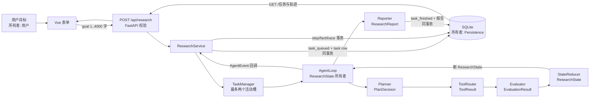
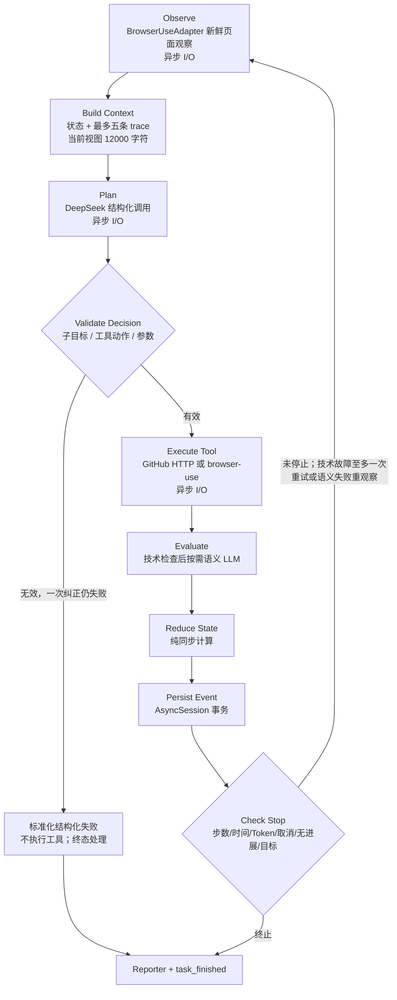
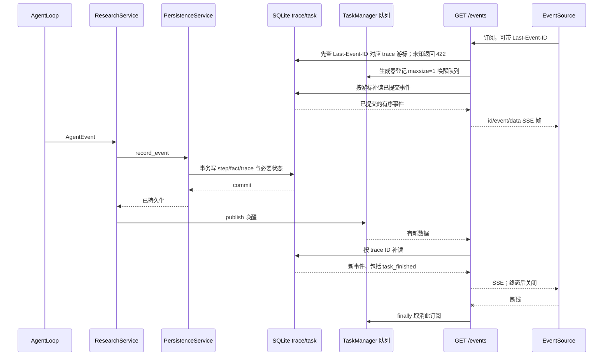
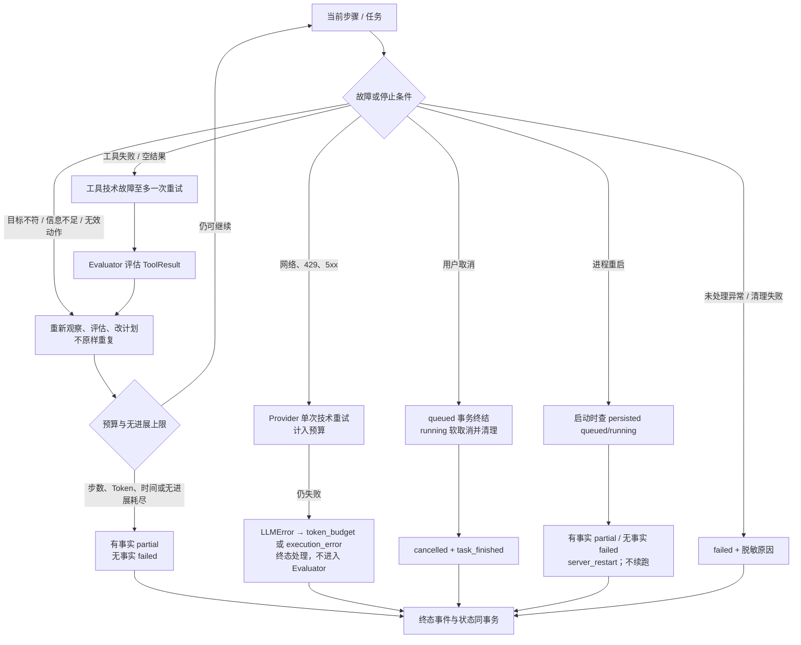
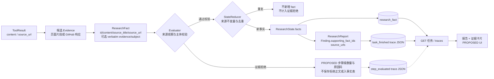
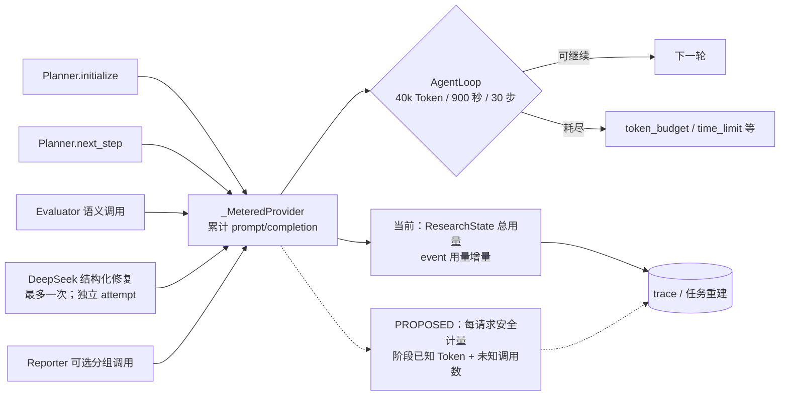
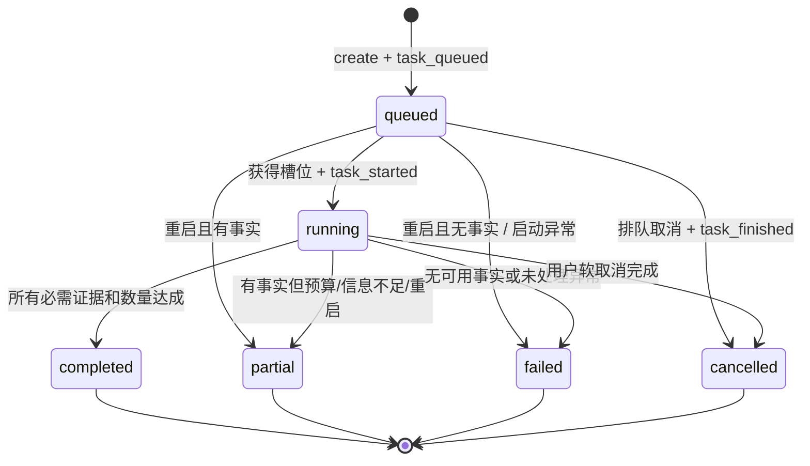

# 数据流、事件流与状态机

状态：**APPROVED（设计）** · 实施未授权 · 当前链路的事实证据见 [Gate 0](10_CURRENT_STATE_AUDIT.md) · 字段与路由以[契约核对](04_DATA_AND_API_CONTRACTS.md)为准。

图中实线标 `VERIFIED` 当前代码路径；明确写 `PROPOSED` 的字段/展示均尚未实现。每个图以括号指出数据所有者。六图不把 SQLite trace 当成事件溯源系统，也不把重启终结画成断点恢复。

## DFD-01：完整研究任务主链路

输入是目标文本；AgentLoop 持有 `ResearchState`，Reducer 返回新状态，AgentLoop 执行事件回调和后续 Reporter 调用；Persistence 独占 SQLite。`Reporter` 只使用已准入事实；报告保存于终态 trace JSON 并由 GET 重建。创建时持久化先于调度。**VERIFIED** 运行期异常由执行路径尝试终结；**PROPOSED** 提交调度在 queued 已提交之后若抛错，应补写真实终态，当前 `ResearchService.create` 没有本地补偿，须作回归测试。

## DFD-02：单轮 Agent Loop

当前 [AgentLoop](../../adaptive_agent/agent_loop.py#L254)在 Planner 前调用 ContextManager，[Planner](../../adaptive_agent/planner.py#L62)又构造并拼接上下文；这是 **VERIFIED 重复构造**，具体 Token 影响 **INFERRED**。每轮 `PlanDecision` 仅一个主动作；技术工具失败可有一次有界重试，语义/信息不足回到观察与重规划，不原样无限重试。`StateReducer` 不作 I/O；`ResearchService` 回调提交事件后才唤醒 SSE。

## DFD-03：事件持久化与 SSE

`AgentEvent.event_id` 是公开 SSE ID；数据库 `agent_trace.id` 是补读游标，两者并不相同。内存队列不承载可靠消息，慢订阅者可重连补读；未知 `Last-Event-ID` 当前返回 422。断线只释放订阅，不取消任务。`task_finished` 与任务终态在一个数据库事务；终态流关闭不等于丢失历史。

## DFD-04：失败、取消与重启

`AgentLoop` 的停止优先级与完整枚举沿用 [V1 Contracts](../contracts/V1_CONTRACTS.md)。`PROPOSED` 对每类技术失败记录可重复的诊断码；不要把所有 `execution_error` 归为外部网络问题。取消竞态要以终态不变和最多一个 `task_finished` 为验收，不保证取消瞬时完成。

## DFD-05：事实与报告数据链

当前 `ToolResult` 未设单独 Evidence 模型；图中的“候选 Evidence”是工具返回内容/URL及可选 `ResearchFact.evidence` 的**逻辑节点**，不是新表。Evaluator 已核对片段与同次工具内容；目标版本聚焦真实误拒诊断、混合结果的步骤级拒绝数量/原因码及 Reducer 边界一致性，不把现有片段检查当作新增功能。历史缺片段时显示“未保存原文”。事实 ID、来源 URL 和最终 Finding 的 `supporting_fact_ids` 构成可追踪链；拒绝摘要不含候选正文、只进入 step trace，不进入事实表或报告。UI 证据卡只从准入事实与报告映射派生；不得伪造证据。

## DFD-06：LLM Token 与成本流

`VERIFIED` provider 成功响应和结构化修复的用量会合并累加，[`ResearchState`](../../adaptive_agent/state.py#L136)仅持有**已报告**总 prompt/completion；当前没有每请求/每阶段持久计量。`PROPOSED` 内部 attempt 计量把首次、技术重试、修复分开，修复阶段与父阶段互斥，避免双计。支持 attempt 记录时，事件记录已知 Token 下界和未知用量调用数；不支持的 Provider 省略阶段分布，不能从总用量推算调用次数。未知调用使完整 Token/实际费用不可验证，UI 显示 `null`/未知而不是 0。40k 是已报告值和请求前估计的运行预算，不能证明实际计费硬上限；突发进程死亡还可能丢失尚未落到事件边界的 attempt 样本。不保存 prompt、密钥、完整网页或外部价格于新增诊断字段。精确字段和对账规则见[04 契约](04_DATA_AND_API_CONTRACTS.md#4-事件-payload事务与重启)。

## 状态机：任务与子目标

**不变量**：只允许 `queued→running`、`queued/running→terminal`；终态不可变。`task_finished` 每任务只落库一次；Reducer 拒绝错误 task ID、重复 step、无效 payload 与终态后事件。并发取消与完成由数据库条件更新裁决；已完成/部分/失败任务的取消返回 `cancelled=false`，已取消返回 `true` 而不改记录。子目标 `pending→in_progress→completed` 需已验证证据，任务终止仍未满足则 `failed`；`depends_on` DAG 不执行。当前重启行为只重建终态报告，不恢复 Agent Loop。事务和 SSE 补读测试见[测试方案](05_TEST_AND_EVALUATION.md)。
