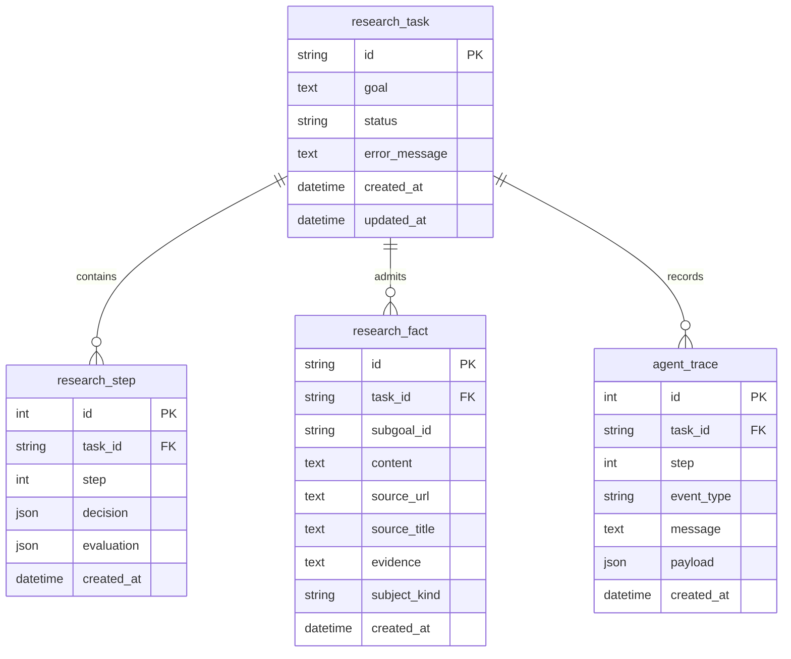

# 数据模型、API 与一致性契约

状态：**APPROVED（目标设计）** · 实施未授权 · 当前事实以 [Pydantic 域模型](../../adaptive_agent/state.py)、[事件](../../adaptive_agent/events.py)、[ORM](../../backend/db/models.py)、[DTO](../../backend/schemas/research.py)与[路由](../../backend/api/research.py)为准。G2-00 权威迁移前，[V1 Contracts](../contracts/V1_CONTRACTS.md)仍是现行 V1 契约。

## 1. 三层模型边界

| 层 | 当前模型与字段（VERIFIED） | 所有者与不变量 |
|---|---|---|
| 领域 | `ResearchState`：task_id、goal、status、step/max_steps、subgoals/facts、visited_urls/search_history、current_subgoal_id、prompt_tokens/completion_tokens、consecutive_no_progress_replans、cancellation_requested、stop_reason、completion_level、UTC 时间 | [state.py](../../adaptive_agent/state.py#L120)；step≤max_steps，当前子目标 ID 必须存在；无 BrowserSession、HTTP/DB session、Task、Queue |
| 领域 | `Subgoal`：id、description、completion_criteria、priority、status、failure_reason；`PlanDecision`：subgoal_id、reasoning、tool/action、target、element_index、value、expected_result | 子目标 pending/in_progress/completed/failed；每轮决策一个主动作且指向未完成子目标 |
| 领域 | `ToolResult`：tool/action、success、content、source_url、error_type/message、metadata；`EvaluationResult`：success/reason/subgoal_completed/should_replan/facts/error_type | 成败与 error_type 一致；成功工具结果才可准入事实，技术/语义/信息不足分开 |
| 领域 | `ResearchFact`：id、subgoal_id、content、source_url/title、subject/kind、evidence、confidence、UTC created_at；`ResearchReport`：task_id/goal/title/summary/findings/comparison/recommendation/sources/markdown/generated_at | 来源 URL 形状合法不等于已观察；Reducer 要求事实来源匹配工具实际 source_url；Finding 的 supporting_fact_ids/source_urls 应指向已准入事实 |
| 事件 | `AgentEvent`：UUID event_id、task_id、闭合 event_type、0-based step、UTC timestamp、message、JSON payload | [events.py](../../adaptive_agent/events.py)；Reducer 纯函数，拒错 task、重复 step、非法转换、终态后变更 |
| API DTO | `ResearchCreateRequest`、`ResearchTaskResponse`、`CancelResponse`；trace 路由直接返回 `AgentEvent` | [schemas/research.py](../../backend/schemas/research.py)；创建目标 trim 后 1–4000 字；DTO 与 ORM 不等同 |
| ORM | `research_task`、`research_step`、`research_fact`、`agent_trace` | [models.py](../../backend/db/models.py)；SQLite 行持久化，`agent_trace.id` 是补读序号，`event_id` 存于 payload |

当前没有独立 `Evidence` 表/类。`ToolResult.content/source_url` 和可选 `ResearchFact.evidence` 是候选证据的现有表示。目标设计保留这一轻量边界；若证据无法重放，应显示“未保存原文”而非构造不存在的片段。`ResearchState` 是运行时领域快照；现有数据库以任务、事实、步骤、轨迹为真相源，重启时从持久数据重建终态所需信息，不提供持续执行快照。

**VERIFIED 当前准入与 PROPOSED 补强**：[Evaluator](../../adaptive_agent/evaluator.py#L127)已要求 `ResearchFact.evidence` 非空、是同次 `ToolResult.content` 的片段，并校验来源 URL 与主体；这不是待新增的完整功能。但 `ResearchFact.evidence` 在域/ORM 仍可空，直接构造事件及历史行的展示需要兼容；混合准入/拒绝时，过滤后的候选和逐项原因没有持久化路径。目标是先用 r12 可重放证据定位误拒，再在 Evaluator 输出的步骤诊断中保留**拒绝原因码与数量**，由 `step_evaluated` 安全持久化；不保存被拒绝候选正文、不建新表。准入事实继续保留来源 URL、fact ID、step 和可对照片段；结构化 GitHub 响应须引用实际返回内容中的片段，不能用模型补写。历史缺片段显示“未保存原文”，不倒填或改分。

## 2. ER 图（VERIFIED 当前四表）



`subgoal_id` 不是外键：子目标存于事件和领域状态，无单独 ORM 表。`ResearchReport` 保存在 `task_finished` trace JSON，非独立 report 表。`research_step.decision/evaluation` 与对应 trace 同事务，但 step 表不另存 ToolResult；完整工具结果在事件 payload。实体图省略了事实的 `subject/confidence` 以保持可读，精确列以 ORM 为准。

**VERIFIED 数据敏感性**：[`step_evaluated` 事件](../../adaptive_agent/agent_loop.py#L312)会携带 `tool_result.content`，[`PersistenceService._redact`](../../backend/services/persistence.py#L40)只替换配置中已知的秘密字符串，然后持久化 payload；不能推断任意网页个人信息已被自动去除。新增 `usage_by_stage` 与 `fact_rejection_summary` 只含枚举/计数/耗时，不能再复制 Prompt、候选正文或网页内容。B01–B03 演示任务只使用公开技术资料，历史 trace 不自动清理或倒填。

## 3. 六路 HTTP API（VERIFIED 当前实现）

| Method / Path | 请求 → 响应 / 成功码 | 主要错误与语义 |
|---|---|---|
| `POST /api/research` | `ResearchCreateRequest {goal}` → `ResearchTaskResponse`；202，立即返回 queued | 422 目标空/超 4000；503 无 DeepSeek key 且不创建任务。当前无创建幂等键，重复 POST 产生新 ID |
| `GET /api/research` | 无请求体 → 最近最多 50 条 `ResearchTaskResponse[]`；200 | 当前每行会读取该任务 traces 重建终态，列表读放大候选风险 |
| `GET /api/research/{task_id}` | 路径 ID → `ResearchTaskResponse`；200 | 404 未知 ID；report/stop_reason/completion_level 从最新持久终态 trace 重建 |
| `GET /api/research/{task_id}/events` | 可选 `Last-Event-ID` header → `text/event-stream`；200 | 404 未知任务；422 未知事件 ID。先校验游标，再在生成器内订阅、补读；断线不取消任务，终态后关闭 |
| `GET /api/research/{task_id}/traces` | 路径 ID → `AgentEvent[]`；200 | 404 未知任务；按数据库 trace ID 有序返回 |
| `POST /api/research/{task_id}/cancel` | 路径 ID → `CancelResponse {task_id,cancelled}`；200 | 404 未知任务；queued 直接终结，running 软取消；已取消返回 true，其他终态 false，不改终态 |

`ResearchTaskResponse` 字段：id、goal、status、error_message、created_at、updated_at、completion_level、stop_reason、report。FastAPI 未显式另定义 500 DTO；未处理服务异常按框架 5xx 处理，不能把内部堆栈视为公开契约。创建响应只说明“已排队”，不表示研究成功。`GET /events` 为异步长连接；其 SSE 帧为：

```text
id: <AgentEvent.event_id>
event: <AgentEvent.event_type>
data: <AgentEvent JSON>

```

事件 ID 与数据库自增 trace ID 不同。`Last-Event-ID` 在同一 task 范围映射为 trace 游标，补读已提交事件并去重；前端可依据 event_id 去重。前端当前直接使用六路 API；不设计额外“事实 CRUD”端点。

## 4. 事件 payload、事务与重启

| 类型 | 当前 payload 与转换（VERIFIED） | 持久化要求 |
|---|---|---|
| `task_queued` | `goal`；确认初始 queued | 创建任务行与 queued trace 同事务 |
| `task_started` | 空；queued→running | 条件更新 queued，状态与 trace 同事务 |
| `subgoals_initialized` | `subgoals`，可选 prompt/completion_tokens；只一次 | 持久 trace，Reducer 应用状态 |
| `step_evaluated` | `decision/tool_result/evaluation/prompt_tokens/completion_tokens`；step 加一 | step、准入 fact、trace 同事务；按 ID 和归一化 URL+content 去重 |
| `cancel_requested` | 空；设置取消标记 | running 任务软取消；最终终态另由 task_finished |
| `task_finished` | `status/completion_level/stop_reason`，可选 report 与用量；终态不可变 | 条件更新 queued/running，终态与 trace 同事务；重复竞争返回无新行 |

[StateReducer](../../adaptive_agent/state_reducer.py#L267)当前严格拒绝额外 payload 键；`step_evaluated` 也由 `extra="forbid"` 校验。**PROPOSED 兼容扩展**：仅在 `subgoals_initialized`、`step_evaluated`、`task_finished` 的顶层 payload 增加可选 `usage_by_stage`；仅 `step_evaluated` 顶层增可选 `fact_rejection_summary`。Reducer 须显式接纳、校验并忽略诊断元数据的状态累计，保留旧 trace 重放能力。不新增事件类型、路由或数据库列。`EvaluationResult` 仍是 LLM 输出契约，不让模型生成受信任的拒绝摘要。

`usage_by_stage` 是**本事件期间的增量**，只在 Provider 能给出逐 HTTP attempt 记录时写入。固定阶段 `initialize|plan|evaluate|repair|report`；出现过调用的阶段值为 `{calls, known_prompt_tokens, known_completion_tokens, unknown_usage_calls, duration_ms, repair_calls}`。`calls` 计实际发出的 HTTP attempt，含无响应重试；`unknown_usage_calls` 计未得到可信 usage 的 attempt，满足 `0 <= unknown_usage_calls <= calls`。`duration_ms` 用单调时钟测每 attempt 耗时并求和；所有值均为非负整数。未调用的阶段可省略，不代表历史旧事件的缺失阶段为零。`repair` 只承接结构化修复请求，其 Token 不再归到原 `initialize/plan/evaluate/report` 阶段；`repair_calls=calls` 仅在 `repair` 阶段，其他阶段为 0。单个完整计量事件中，各阶段 `known_*` 之和须等于该事件现有 `prompt_tokens/completion_tokens` 增量，不能再计入 `ResearchState` 第二次。`unknown_usage_calls>0` 时，UI 的**完整**阶段/任务 Token 显示 `null`（未知），同时单独显示已知下界；不能把未知调用当作零。旧 trace 或不支持 attempt 记录的 Provider 缺 `usage_by_stage` 时，阶段调用数、用量与覆盖状态均为未知；可独立显示现有已报告总用量，但不得推算 HTTP 次数、修复次数或阶段分布。跨事件聚合按 event_id 去重；只要任一事件缺阶段元数据，任务级阶段完整性为未知。金额成本未有可核验计费口径，暂不显示。

当前 [DeepSeekClient](../../adaptive_agent/llm/deepseek.py#L56)把首次结构化请求与修复请求的 usage 合并返回；因此仅在事件 JSON 加字段不能得到修复阶段。G2-02 须设计一个内部、仅含阶段/请求类型、耗时、报告用量或缺失标志的 Provider attempt 回调（或等价结果元数据），覆盖首次、技术重试与修复请求；**每个实际 HTTP attempt 恰好生成一条计量样本**，无响应亦生成 `unknown` 样本。`_MeteredProvider` 对支持该回调的 Provider **只通过一条计量路径**累计已报告 Token，不能同时按 attempt 和 `StructuredCompletion` 合计；在每个现有事件边界按未入账样本形成增量，异常终结时未入账样本随 `task_finished` 保存。不支持 attempt 记录的可替换 Provider 仍沿用结构化调用返回的已报告总量，**省略** `usage_by_stage`，不得编造阶段、HTTP 调用数或修复存在性。现有 DeepSeek 缺 `usage` 响应会抛 `invalid_response`，对应调用的 usage 状态应为未知；网络重试可能没有响应，实际计费亦不可验证。40,000 Token 是基于已报告值及请求前估计的运行预算，无法证明实际计费硬上限；突发进程死亡时尚未到事件边界的 attempt 样本可能丢失，重启报告须标计量不完整。安全元数据不包含 prompt、响应正文、页面正文、URL 查询密钥或凭据。

**预算判定顺序**：每个结构化逻辑调用前，`_MeteredProvider` 先按已报告累计量检查剩余额度；DeepSeek 再以请求体 UTF-8 字节数加余量保守估计 Prompt，并用剩余额度限制 `max_tokens`，估计容不下一次输出时在发请求前报 `budget`。首响应的已报告 usage 在结构化修复前扣除；一次无 usage 的网络/429/5xx attempt 目前仍可能触发唯一一次技术重试，不能把该未知消耗从剩余额度精确扣除。**目标规则**保留有界重试，但在诊断视图把预算可验证性显示为“未知”（由缺失用量推导，**不是新增持久字段**），不得声称 40k 为实际计费硬上限；成功响应缺 usage 继续按 `invalid_response` 失败终结，不允许按零推进规划。时限/步数/已报告预算由 AgentLoop 判停；Provider 内部重试和修复在可观测额度内受一次上限约束。G2-02 以 39,999/40,000 边界、修复前扣量、未知重试和非 budgeted Provider 分别验证，不以低 Token 数替代真实任务成功。

`fact_rejection_summary` 由 Evaluator 在解析模型 `EvaluationResult` **之后**，对原候选事实执行确定性的本地验证而生成，不采信模型给出的诊断字段。G2-04 可用小型 `EvaluationOutcome(evaluation, rejection_summary)` 内部返回值把摘要交给 AgentLoop；`EvaluationResult` 本身和模型 Prompt schema 不加该字段。摘要仅保存 `{candidate_count, supported_count, rejected_count, reason_counts}`，计数非负且 `supported_count + rejected_count = candidate_count`；`reason_counts` 的键限定为 `evaluation_failed|missing_source|source_mismatch|missing_evidence|evidence_not_observed|subject_mismatch|subgoal_mismatch|invalid_subject`，值总和等于 `rejected_count`。模型整体判为语义失败但给出候选时，全部候选计 `evaluation_failed`；技术失败未生成候选时三个计数为零，失败原因仍由 `EvaluationResult.reason/error_type` 表示。一个候选若有多种问题，按确定的校验顺序只记**首个**原因。`supported_count` 表示通过证据校验的候选数，**不等于**最终新增 fact 行数；重复去重仍由 Reducer/持久化边界执行，不混入证据拒绝数。UI 仅显示步骤级数量与原因码，不保证展示每步去重数，也不展示被拒绝候选正文。G2-04 的回归须证明混合候选、重复事实与旧事件均可正确读取。

事件大小/脱敏规则沿用 Persistence 的安全处理，并增加缺失 Provider 用量、混合事实拒绝、旧 trace、取消/异常路径回归。若跨版本读取确认 JSON 兼容有问题，先写迁移评估，不修改现有 SQLite。

**当前一致性**：`record_event` 中状态条件更新与 trace 一起提交；`step_evaluated` 内 step/fact/trace 原子化；`task_finished` 最多一次。`ResearchTaskResponse` 从终态 trace 重建 report 与状态，避免终态读竞态。启动 `finalize_unfinished` 将残留 queued/running 按事实有无终结为 partial/failed，并生成 `server_restart` 报告；这不是 checkpoint。现有 `metadata.create_all` 仅创建缺表，不迁移旧列；旧本机 DB 的任何结构变更必须先备份/复制、在隔离副本验证兼容，再经批准选择迁移方式。四周目标不引入 Alembic，除非真实 schema 改动证据使手工兼容策略不足。

## 5. 事实、报告及前端数据映射

- **事实准入**：Evaluator 对成功工具结果做技术/语义与来源检查，Reducer 再要求 fact URL 与观察到的 ToolResult URL 归一化匹配；事实 ID 冲突不得改指向不同证据。事实重复键为归一化 `source_url + content`，访问 URL/查询另由 Router/Reducer 抑制。
- **报告映射**：Reporter 只从准入 `ResearchFact` 形成 `Finding.supporting_fact_ids` 和 `source_urls`；未满足字段写明未知/未完成。终态 report 的 task_id/goal 必须匹配任务。没有报告或失败时，UI显示真实 stop_reason 和可用的持久轨迹。
- **PROPOSED UI**：证据卡只从 `step_evaluated` 的准入事实及 report 的 fact ID 映射生成；步骤级拒绝诊断读可选 `fact_rejection_summary`，旧 trace 未记录时显示“未记录”，不能从缺失字段推断零拒绝。失败诊断从终态 stop_reason、技术/语义 error_type 和可选 `usage_by_stage` 生成。不能把 `ResearchTaskModel.error_message` 已存在但未填充的字段当作可靠失败详情。
- **兼容测试**：旧 trace 无 `usage_by_stage` / `fact_rejection_summary` 仍可重播；新旧事件均满足 Reducer；GET/SSE 的既有六路响应字段仍可被当前 Vue 客户端读取；并发取消、终态重复事件和重启报告仍通过事务与接口测试。
