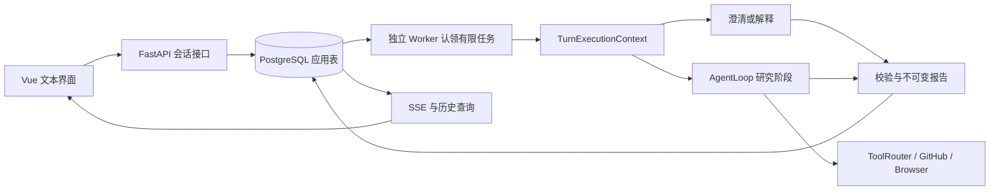

# ADR-0007：交互式、有证据的技术选型会话

- 日期：2026-10-26；设计：`ARCH-20261026-v3.1`；状态：**需求与方案 B／默认上界已获人批准，仅本轮文档同步获授权，新业务实现未授权**。
- 权威：[规格](../../../SPEC.md)、[计划](../../../PLANS.md)、[现行契约 V2](../../contracts/CURRENT_CONTRACTS.md#v2交互式决策会话契约2026-10-26-已批准尚未实现)、[任务及验收](../../features/DECISION-001/tasks.md)。本 ADR 不替代冻结评测协议。
- 关系：保留 [ADR-0005](0005-windows-worker-wsl-postgres.md) 的 Windows API／Worker／WSL PostgreSQL；仅替代 [ADR-0006](0006-python-open-source-decision-agent.md) 的 Python-only、主要技术负责人和单轮产品边界，历史原文不修改。

## 问题与需求依据

主目标是求职工程证据，真实场景用于检验价值。本人／同学需要为居家老人陪伴、日常问答应用选择 ASR、TTS、对话及组合，许多条件尚未确定。原 Python 项目字段覆盖不了模型／云服务，单轮报告也不支持用户确认条件、报告后追问和继续补查；这两项是经用户确认的具体缺口。高星项目和岗位研究支持做深工具、上下文、状态、评测与交付，不支持仅因功能少而扩大成通用 Agent。原真实研究 No-Go 是质量缺口，不能靠改名解除。

初版文本交互、本机展示，覆盖三类组件和组合；不实现养老系统、语音输入输出、音频实测或自动部署。详见 [需求](../../features/DECISION-001/spec.md)；产品与个人理解分开验收。一个月初版、再 1.5 个月最终版是目标，未确定工时或新增预算。

## 候选与取舍

| 方案 | 状态／数据归属 | 收益 | 成本和风险 |
| --- | --- | --- | --- |
| A：父子有限研究任务 | 从 parent／root task 链重建条件、证据与报告 | 少建会话表，旧任务路径复用更多 | 版本、活动轮次、历史和复用语义散入任务元数据；仍须实现并发、归属和快照，不是无状态方案 |
| B：显式会话、条件版本、轮次与报告 | 应用表直接保存会话；每轮复用有限 PgTask | 交互和证据归属清晰，历史不可变，方便后续补查与对照 | additive migration、事务与恢复复杂度上升，必须防旧 Worker 和跨轮陈旧证据；无新框架可替代这些约束 |

选择 B。保留维持／收缩原选型场景的结果：仍专注选型，扩展的是主体类型和同一决策内交互；没有扩成长期自治、通用聊天或多 Agent 平台。

## 数据流和归属

Session 保存 owner、版本与活动轮次；InputRevision 保存用户已接受条件及出处；Turn 保存输入和有限 operation task；ReportSnapshot 不可变；SessionEvidenceRef 引用来源 task／fact／哈希。所有业务真相与用户事件归应用表，检查点只辅助执行，不另加内存队列、向量库或框架。API 不直接调用模型；澄清和解释也经 Worker，等待用户不持租约。

提交先判幂等后做版本 CAS，同键同 body 在版本前进后仍返回原轮次。同会话只一个未终结轮次，429／409 不留 revision／turn／task。锁顺序 scheduler guard → session → task → 附属；输入、条件、task／turn／event／active 和终态发布各有原子事务，全部终态含排队取消、超时、失租、第二次故障均释放 active。旧六路 API／DTO／六态／七事件独立保留；新内层研究 phase finished 不能提前终结外层轮次。

候选区分 repo／model／cloud_service 和 asr／tts／dialogue。跨轮仅校验同 owner／session 的 origin_task_id＋fact_id＋content_sha256 引用，保留原时间与核源快照；不混进当前 task facts 或改旧同任务引用规则。价格／版本／可用性作当前建议前重查，失败写未知；解释旧报告可使用带日期历史。只注入有界投影，页面和旧报告不能成为用户已确认条件。官方声明、分析、实测分层；组件组合未经集成不能声称端到端效果。详细字段和接口以契约为准。

## 轮次执行、默认上界及故障

每轮 active set 每类 2 个、共 6 个候选，展示至多 3 组合；历史保留其他候选供用户分批选择，不暗删、不称穷举最优。900 秒自 queued 起，累计 40,000 Token，研究报告预留 4,096；澄清／规划 1,024、解释／评估 2,048、最终报告 4,096 且受实际余额限制。

仅 decision_turn 注入 TurnExecutionContext，唯一拥有 provider、recorder、meter、原截止时间和累计 usage。AgentLoop 只执行研究／phase，不重置上下文或关闭共享 provider；工具资源由 Loop 清理，provider 最外层关闭一次。每个物理修复／重试入账一次，研究结果确定性导出，不重复生成旧 LLM 报告。阶段输出、状态与 call coverage 校验并持久后才能推进，恢复校验输入／引用／投影哈希并至多重认领一次。

started 无结果保留 unknown_outcome／未知费用且停线；completed 调用但阶段输出未提交保留已知费用，以 phase_output_not_committed 诚实 partial／failed，**不自动重调，也不改成 unknown**。完整检查点可按原截止和累计使用恢复；不重放结果不明外部动作。未实现和未故障注入不得写已可靠。

## 兼容迁移和本机安全

旧 Worker claim_next 不区分 kind，也没有 schema 握手。未来迁移用 decision_turn INSERT／UPDATE 的数据库护栏，事务 current_setting('app.execution_protocol', true) IS DISTINCT FROM 'decision-v2' 即拒绝（含 missing／NULL），禁止 kind 降级绕过；新事务 SET LOCAL，禁止池／role／database 默认值。它是旧二进制兼容协议，不是认证或对持库凭据恶意进程的防御。用现有常规迁移权限，不足则另议，不扩权。

迁移顺序：停止全部旧 API／Worker → additive migration → schema／能力核对 → 兼容版本 → 新入口。回滚关闭新入口、保留表和历史，仅退到理解 kind／护栏的兼容基础版，不 destructive downgrade。本轮不执行任何迁移。

全部新接口含 GET／SSE 在对象读／流前验精确配置 loopback Host；写请求加本机 Origin＋JSON 校验，缺失／null／跨站 403，无通配 CORS。owner 由服务端本机合成身份决定，逐 session／turn／report／ref／cursor 校验；不宣称五账户或 LAN 已通过。公共页面及 URL／渲染不可信，只用公开无凭据 HTTP(S)，不执行任意代码、候选语音服务或私有数据。原 DNS／重定向／私网安全未知保持。

## 成本门槛与范围

新付费模式默认关闭，包含讨论／澄清；原 pilot 额度不是新场景资金。独立后续资金设计须明确服务端 grant／阶段与金额、价格快照、跨库 ledger checkpoint、旧已知／未知及在途预留、不重复／不漏计和逐次授权。未解决不运行新真实调用；不允许客户端或聊天开通资金。原 49＋30＋200＋20＝299 元限制不变。

只新增与定位直接相关的文档、需求、计划和契约。共享工程流程、Skills、角色、模型、MCP、权限均不改，browser-use／SQLite／r12／冻结协议和失败记录不动。后续模块依赖 T07→T08→T09→T10→T11，T12 资金门槛独立，T13 真实任务和个人验收需前置通过与单独授权。

## 审查、批准和状态

设计候选 v2→v3→v3.1 由 fresh-context architecture_review 独立进行架构／安全技术审查；关闭的重点包括统一执行上下文、已完成调用丢阶段输出、所有终态 active 释放、旧 Worker 认领、NULL setting 和 GET／SSE Host 边界。最终设计审查 DONE、无未关闭 P0–P3；这是设计结论，未运行实现测试，不代替本轮最终文档 diff 独立审查或未来代码审查。

人的明确批准原文：“批准方案 B 及上述默认上界，仅同步所列项目文档与契约”。文档同步实际命令、内容身份和独立审查见 [DEC-DOC-SYNC-20261026](../../features/DECISION-001/tasks.md#dec-doc-sync-20261026文档同步任务)。新增目标全未实现／未业务验收；原 r12／P-02 No-Go、九题十五次、五账户及恢复备份正式门槛不变。
