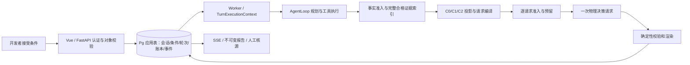

# ADR-0008：M1 完整工程闭环与开发准备基线

状态：PREP-BASELINE-v4.3 已由工程负责人明确批准；2026-10-27 执行限定 16 份文档同步。业务实现、安装、真实运行及 Git 写操作另行授权。实际文件审查与检查结果见 [连续任务记录](../../features/DECISION-001/tasks.md)。本 ADR 的批准不表示目标已实现。

## 问题、证据和替代范围

产品是面向开发者的交互式技术选型与研究决策助手。语音组合只是任务输入，不能成为产品模块枚举。P-02/r11 三题均无 full，r12 的 18 次尝试亦无 full；P-01 的 48/48 假任务只证明被测执行路径。旧切片已经实现部分事实矩阵及条件建议，但不足以证明新方向的产品价值。M1 必须把记忆、上下文、真实评测、优化、个人实践接入完整调用链。

本决定保留 [ADR-0005](0005-windows-worker-wsl-postgres.md) 的 Windows API/Worker、WSL PostgreSQL 与现有 AgentLoop。保留 [ADR-0007](0007-interactive-evidence-decision-sessions.md) 的 Session/InputRevision/Turn/ReportSnapshot/SessionEvidenceRef、事务与旧接口兼容；只替代其中语音专属分类、本机合成 owner、资金待设计及核心能力后移的前提。ADR7 原文和历史授权不改。新基线由 SPEC、PLANS、现行契约和本 ADR 联合表达；正式放行仍由冻结协议决定。

## 候选比较与已批准选择

| 议题 | 2–3 个实质选项 | 选择、代价与改变决定所需证据 |
| --- | --- | --- |
| 产品范围 | 固定语音流程；少量候选的通用技术决策；无限通用 Agent | 选中间项，主流程比较已有候选、澄清条件、短名单/排除与下一步验证。发现候选是受限辅助。新任务若证明当前角色模型不足再单独扩展。 |
| 记忆 | 仅同会话；同会话＋显式跨任务来源线索；自治长期偏好/向量记忆 | 选第二项，Pg 索引和确定性检索，默认关闭跨任务。增加导入核源、撤销和隔离测试成本；只有真实检索失败且简单索引不足才考虑向量化。 |
| 上下文 | C0 近窗；C1 确定性相关选择；C2 相关选择＋关键证据保护 | 三者都进入 M1 对照，部署候选 C2。保护集合在裁剪前从全量合格索引构建；若无实际选择压力不作改善结论。摘要与后台压缩暂不引入。 |
| 报告 | 多次生成/修复/润色；一次决策请求＋确定性渲染；纯规则建议 | 新研究路径选一次物理决策请求，非法输出诚实失败/合格 partial。节省隐藏调用但可能牺牲单次成功率；未来改变必须有失败证据、费用和新批准。 |
| 资金 | 多库各自预算；F1 单一 Pg 权威；只靠账户余额 | 选 F1，所有付费入口逐物理调用预留/结算，迁移和恢复复杂度前置。余额、预算与 grant 是不同对象。 |
| Token | OpenCode 字符估算；官方 tokenizer 直接硬准入；离线影子资格验证后再决定 | 选影子验证；当前硬准入规则不自动替换。原始请求缺失的历史调用不能宣称精确复算。 |
| 请求审计 | A 完整有界编译输入＋冻结工件重建；B 再存 compiled body；只存摘要 | 已确认 A。保留重建依赖与最终哈希，不额外持久化 compiled body。不能重建时标不可回放，不能拿审计输入重发完成/未知调用。 |

## 模块与数据流

规划、评估与工具仍可以有有界多步；“一次”限定最终决策阶段，不能借嵌套旧 Reporter、repair、technical retry 或润色突破。补查必须由用户明确新开一轮。假供应商纵切先行，真实 pilot 在 T09 和资金前置满足、另获授权后尽早进行，不等全部 UI。

| 信息 | 所有者、写读及可信程度 | 生命周期、冲突与恢复 |
| --- | --- | --- |
| 用户目标/已接受条件 | 同 owner 的 Session/InputRevision；仅用户接受/编辑可写，模型与网页只能提议 | 不可变 revision；新版本显式替代旧条件，调用绑定精确版本；不从聊天摘要重建条件 |
| 临时工作上下文 | 编译器从条件、事实索引、有限历史和失败记录投影 | 每次可重建，记录选择/裁剪原因；不是事实或恢复权威 |
| 执行与检查点 | Pg task/attempt/phase/call ledger，fencing 写入 | 至多一次安全重认领，完成调用不重发，unknown 停线；检查点不拥有费用/事实/终态 |
| 来源事实 | 当轮 task 的准入事实，来源、片段、原观测时间、哈希和核源快照 | 不可变并保留历史；冲突并列，动态价格/版本/可用性在当前建议前重核 |
| 同会话跨轮引用 | SessionEvidenceRef 验 owner/session/origin_task/fact/hash | 不复制为本轮新事实，不刷新时间，旧核源不自动转移新报告 |
| 跨任务线索 | owner 显式导入已人工核源报告中的来源定位；默认关闭 | 导入起绝对 7 天、最多 5 条、读不续期；原观测与人工复核时间分开；撤销/过期先过滤，重新访问才能成为本次事实 |
| 长期偏好/程序规则 | 本首版无自动写入者 | 不从失败自动学习规则或跨用户共享；需要另行需求与验证 |
| 报告/事件/费用 | Pg 应用表及绑定哈希的审计工件 | 报告只追加；事件事务提交；已知与未知费用分开，备份恢复不倒退资金/撤销权威 |

## 物理调用、撤销与恢复

每次发送必须消耗一个持久、单次、不可转用的 admission，绑定 owner/session/turn/revision、精确请求哈希、线索及版本、grant、计价和恢复代次。admit 与 revoke 共享控制行锁；全局稳定锁序及排序后的 hint ID 避免反向锁死。admission 提交前不得发送。撤销先提交则后续准入拒绝；准入先提交则只允许该已绑定请求作为在途审计保留，不承诺撤回网络请求，随后准入重新查撤销。提交结果不明不发送，未知物理结果不重试。

资金 F1 只有一个活动 Pg 权威，项目/分配/grant/调用预留与结算原子，所有旧新入口都经保护。旧 SQLite 账目只核对和按稳定身份去重导入，不是第二权威；冲突不得静默覆盖。未知结果保留预留并关闭新增付费。grant 必须绑定负责人逐次授权的代码/模型/用途/阶段/轮数/金额/计价/代次/owner，客户端、聊天、模型不能自行创建。

恢复默认 paid_disabled；新恢复代次使旧登录会话与 grant 失效。提升为权威前停止旧 authority，核对独立保存的最新 ledger/grant/revocation 高水位、备份之后的供应商及在途账，不能使用同一旧备份证明“最新”。最新账目或撤销记录不可获得时保持付费及来源线索注入关闭。保留未结算调用，不因恢复回退而释放余额。

## 上下文、Token 和审计 A

C2 先在全量 eligible 索引识别支持/反证/冲突/限定语及失败线索，再裁剪，不能只在已截短窗口里找反证。记录“未识别”“未绑定”“被裁剪”的不同失败。每次条件 revision 重算保护集合；关键最小证据装不下时分批或诚实 partial/unknown，不丢限定语换完整报告。

分别控制模型 context window、整轮累计 40,000 Token 和人民币费用。编译覆盖 system、schema、工具描述、条件、投影、失败与输出限额。OpenCode 的 chars/4 与 15% buffer 是启发式，不能作为中文或资金保证；DeepSeek 官方 tokenizer 在 M1 离线影子验证模板/特殊 token/模型别名映射及中英 schema 样本，与可取得的 provider usage 对照，不能自动替代硬准入或增加线上调用。Windows 无已核对版本 wheel，隔离 Linux 路径只是候选，无安装授权。

审计 A 保存有界完整编译输入、实际可取得的冻结模板/schema/config/defaults/编译器及依赖工件、排列顺序、模型参数与输出上限、内容哈希；避免无界原聊天。不另存 compiled body。重建校验分别报告 canonical JSON 语义、wire bytes 哈希和线上 Token 的一致性；缺工件或不确定序列化则标不可回放，不夸大哈希证明范围。其他允许修复的旧阶段若依赖首次响应片段，也必须保存该有界输入依赖。审计输入可重建完整内容，按同 owner 控制访问/导出、加密备份，存储与发送前拒绝秘密；认证 header/key 不记录。此材料不能作为重发 completed/unknown 的授权或恢复事实。

## 独立审查与批准边界

PREP-BASELINE-v4.3 整体设计在讨论阶段完成独立技术及安全审查，涵盖保护集合前置、单请求报告、请求审计 A、单次 admission 与撤销锁序、恢复高水位等修订；这是设计审查，不是实现或运行验收。负责人最新指令“PLEASE IMPLEMENT THIS PLAN”明确批准所列 16 份文档同步与实际文件独立审查。实际落地后的审查、发现、修复及内容指纹分别记录在 tasks.md 与本轮审计目录。

四周、每周 15–20 小时是目标；本人参与估算 66–96 小时，首周校准，超窗必须提出投入/期限选择，不削减核心验收。M2 用于稳定性和证据深度。第一项可另授权业务任务是 DEC-T07-01 operation_kind 与旧 Worker 防护，仅 PgTask/store/迁移/认领边界及隔离 PostgreSQL 假任务测试。
